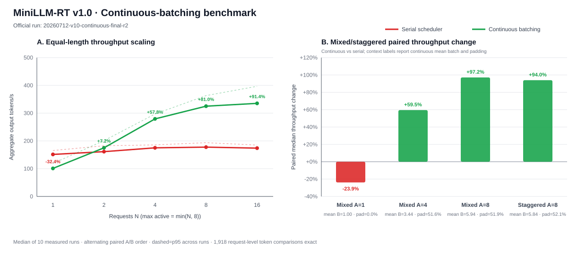

# MiniLLM-RT

MiniLLM-RT 是我用来学习 LLM 推理 Runtime 的单卡 C++/CUDA 项目。它以
Qwen2.5-0.5B-Instruct 为测试模型，在 TensorRT 上实现了请求级 KV Cache、
FIFO 准入、逻辑 KV block 管理、decode continuous batching、融合 KV staging
kernel 和设备端 greedy sampler。

项目已经包含一个自定义 CUDA 后处理算子，但还没有替换 TensorRT 内部的 Transformer
算子，也不是一个完整的在线服务。它更关心 Runtime 应该怎样管理后端能力、请求状态、
KV 生命周期、采样数据流和多请求 decode。

> 安全边界：只加载可信来源的模型、ONNX 和 TensorRT Engine。默认脚本固定到
> Qwen 的完整 commit revision；自定义来源需要显式确认。漏洞报告和威胁模型见
> [`SECURITY.md`](SECURITY.md)。

## 做了什么

推理链路如下：

```text
Qwen tokenizer / Hugging Face golden
                |
                v
       ONNX prefill + decode_batch
                |
                v
          TensorRT engines
                |
                v
 ModelSpec -> GenerationBackend -> RuntimeSession
                |
                v
 FIFO admission -> BatchPlan -> batched decode
                |
                v
 KV gather/scatter -> device argmax -> release
```

主要实现包括：

- 用 `ModelSpec` 描述模型层数、GQA heads、dtype、tensor 命名和 EOS；
- 每个请求独立持有 KV Cache，完成后释放 slot、block 和显存；
- serial round-robin 作为对照，每个请求每轮单独 enqueue；
- continuous batching 把一轮中的活跃请求合并为一次 `enqueueV3`；
- mixed-length batch 按本轮最大 past length 补齐，并为每行生成独立 mask 和 position ID；
- 每个请求只保留一份 fixed-stride KV slab，CUDA kernel 融合 batch gather/zero padding，
  decode 后只把新 token 的 K/V row 原位追加到持久 cache；
- 自定义 CUDA argmax 每个 batch row 只回传一个 `int32` token ID，保留 host logits A/B 路径；
- generation backend 用 capability 描述 batch 上限、padded/ragged 布局和 device sampling；
- CTest、HF/ORT 数值检查、HF token exact 和 benchmark 不变量检查。

持久 KV 已经从 A/B ping-pong slab 改为单份 fixed-stride slab。现有 TensorRT Engine
仍将 full present 写到 transient dense staging，Runtime 只把最后一个 K/V row 追加回
持久 cache。因此这里实现的是 request-cache 的原位追加，不是 Engine output alias，
也不是 PagedAttention。

## 参考结果

以下结果来自 RTX 5060 Laptop GPU、CUDA 12.9、TensorRT 10.11、
Qwen2.5-0.5B-Instruct FP16。不同 GPU、温度和功耗状态下绝对吞吐会变化。

### Device argmax

对 mixed B=4、prompt=8/32/128/256、output=32 做 6 组交错顺序的 host/device
配对测量；每次先完整 warmup 一轮。device 路径与 host 路径的 1,536 个生成 token
逐项一致。

| 指标 | host logits + CPU argmax | CUDA argmax |
| --- | ---: | ---: |
| 每个 decode batch 的 D2H | 1,215,488 B | 16 B |
| D2H 缩减 | 1.0x | 75,968x |
| makespan 中位数 | 790.668 ms | 640.944 ms |
| 配对改善中位数 | — | 14.48% |
| 配对胜出 | — | 5/6 |

CUDA reduction 本身平均约 0.251 ms。完整 makespan 的中位数下降 18.9%，但 55 W
笔记本 GPU 的频率波动明显，所以报告与结论优先使用确定性的传输量缩减，并同时报告
配对分布。完整协议、12 次原始 makespan 和正确性边界见
[`docs/device_argmax.md`](docs/device_argmax.md)。

### 单份 KV cache 与融合 staging

在相同 mixed B=4 workload 上，对主线 A/B ping-pong 实现和新实现做 6 组交错配对；
两条路径都使用 device argmax。12 次测量中的 1,536 个 token 逐项一致，另有
4 请求 × 128 token 长序列门禁完全一致。

| 指标 | A/B slab + 逐 tensor copy | single slab + fused CUDA |
| --- | ---: | ---: |
| 4 请求持久 KV 显存 | 13,762,560 B | 6,881,280 B |
| steady batch scatter 流量中位数 | 6,021,120 B | 49,152 B |
| steady gather 时间中位数 | 2.683 ms | 0.162 ms |
| steady scatter 时间中位数 | 4.133 ms | 0.0037 ms |
| makespan 中位数 | 491.039 ms | 296.007 ms |
| 配对改善中位数 | — | 37.96%（5/6） |

持久显存缩减 50% 和每步 48 KiB append 是布局决定的确定性结果；完整的原始配对、
统计口径、Compute Sanitizer 与边界说明见 [`docs/inplace_kv.md`](docs/inplace_kv.md)。

### 历史 KV cache 与 continuous batching 基线

KV Cache 对照使用 prompt=256、output=32，10 次配对测量的中位数：

| 路径 | TPOT |
| --- | ---: |
| full recompute | 12.850 ms |
| one-token KV decode | 6.496 ms |

Continuous batching 使用相同的 prefill 和 batch decode Engine。表中的变化率按同一
repeat 配对计算，不是两列中位数直接相除。为保持历史 v1.0 结果可复现，现有
`benchmark-v09`/`benchmark` runner 显式使用 `--sampling host`；device sampler 使用
上面的独立 A/B 协议。

| workload | serial tok/s | continuous tok/s | paired change | past-KV padding |
| --- | ---: | ---: | ---: | ---: |
| equal n=1 | 151.36 | 100.99 | -32.39% | 0% |
| equal n=4 | 175.06 | 279.30 | +57.79% | 0% |
| equal n=8 | 177.61 | 325.09 | +80.96% | 0% |
| mixed n=16 / active=8 | 139.63 | 275.16 | +97.15% | 51.88% |

这张表记录的是融合 staging 之前的 v1.0 基线：当时 B=1 没有减少 enqueue，却增加了
逐 tensor gather、memset 和 scatter，所以是负收益；batch 变大后，合并提交才覆盖
这些固定成本。新的融合 kernel 显著降低了 staging 固定成本，但不改写历史数据。



## Docker 环境

推荐用 Docker 复现。宿主机只需要 Linux、Docker、NVIDIA 驱动和
NVIDIA Container Toolkit，不需要另外安装 CUDA。验证环境对应的主要版本为：

| 组件 | 版本 |
| --- | --- |
| 基础镜像 | 构建时显式传入、带 `sha256` digest 的 TensorRT-LLM release 镜像 |
| TensorRT-LLM | 1.0.0 |
| CUDA | 12.9 |
| TensorRT | 10.11.0.33 |
| Python | 3.12 |
| PyTorch | `2.8.0a0+5228986c39.nv25.6` |
| Transformers | 5.16.1 |
| ONNX | 1.22.0 |
| ONNX Runtime C++/Python | 1.26.0 |

建议至少预留 8 GB 显存和 12 GB 磁盘。模型约 1 GB，导出的 ONNX 与 TensorRT
Engine 会再占用数 GB。Engine 与 GPU 架构相关，应在实际运行的 GPU 上构建。

先确认容器能够看到 GPU：

```bash
docker run --rm --gpus all nvidia/cuda:12.9.1-base-ubuntu24.04 nvidia-smi
```

历史 benchmark 来自项目的 `minillm-dev` 容器。该容器使用 TensorRT-LLM release
镜像，不是普通的 PyTorch 基础镜像。安全更新后的 Python 依赖需要重新生成本地
ONNX/Engine；仓库中的历史性能数字不用于声称新依赖版本带来相同绝对耗时。

镜像 tag 会随 NVIDIA 发布更新。Dockerfile 因此不提供默认基础镜像；构建前先拉取
候选镜像并记录它的仓库 digest：

```bash
docker pull nvcr.io/nvidia/tensorrt-llm/release:latest
docker image inspect nvcr.io/nvidia/tensorrt-llm/release:latest \
  --format '{{json .RepoDigests}}'
```

从输出中选择 `nvcr.io/...@sha256:...`，检查来源后用完整 digest 构建：

```bash
docker build \
  --build-arg BASE_IMAGE='nvcr.io/nvidia/tensorrt-llm/release@sha256:<digest>' \
  -t minillm-rt .
```

省略 `BASE_IMAGE` 会直接拒绝构建。Dockerfile 还会检查 TensorRT-LLM 1.0.0 和
TensorRT 10.11，并对下载的 ONNX Runtime C++ 压缩包执行 SHA-256 校验。候选镜像
版本不匹配时构建会立即失败，避免继续生成不可比较的 Engine。

首次构建需要从 `nvcr.io` 拉取 NVIDIA 镜像。如果本机尚未登录 NGC，先按 NGC
页面说明执行 `docker login nvcr.io`。

创建一个 volume 保存模型、ONNX 和 Engine，然后进入容器：

```bash
docker volume create minillm-artifacts

docker run --rm -it --gpus all --ipc=host \
  -v "$PWD:/workspace/MiniLLM-RT" \
  -v minillm-artifacts:/workspace/trtllm_workspace \
  minillm-rt
```

## 快速开始

下面的命令都在仓库根目录执行。先检查 GPU、基础工具和关键版本：

```bash
./scripts/quickstart.sh check
```

第一次完整运行会下载固定 revision 的模型，导出
prefill/decode_batch ONNX，在当前 GPU 上构建 TensorRT Engine，然后编译 C++、
执行 6 个单元测试（包含两个真实 CUDA kernel test）和一个四请求 continuous-batch 冒烟测试：

```bash
./scripts/quickstart.sh all
```

模型固定为：

```text
Qwen/Qwen2.5-0.5B-Instruct
revision: 7ae557604adf67be50417f59c2c2f167def9a775
precision: strongly typed FP16, TF32 disabled
engine max sequence length: 512
decode batch profile: B=1/4/8, past=1/128/511
```

成功时应看到：

- CTest `6/6 passed`；
- Runtime 输出四个请求的 token 序列；
- `/tmp/minillm_requests.csv` 中四个请求均为 `length` 或 `eos` 完成；
- `/tmp/minillm_batches.csv` 中每个 decode batch 的 `enqueue_count` 为 1。

脚本也可以分步执行，已存在的 ONNX 和 Engine 不会重复构建：

```bash
./scripts/quickstart.sh model
./scripts/quickstart.sh artifacts
./scripts/quickstart.sh build
./scripts/quickstart.sh test
./scripts/quickstart.sh smoke
```

已有模型和 Engine 时，下面一条命令会重新编译、执行 CTest 和真实 TensorRT smoke：

```bash
./scripts/quickstart.sh verify
```

如果不使用默认的 `/workspace/trtllm_workspace`，先设置：

```bash
export MINILLM_WORKSPACE=/path/to/minillm-workspace
```

CUDA 源码默认按当前 GPU 的原生架构编译。跨机器构建 fat binary 时可以显式覆盖：

```bash
MINILLM_CUDA_ARCHITECTURES='80;89;90;120' ./scripts/quickstart.sh build
```

## 复现 continuous batching benchmark

快速开始完成后运行完整 v1.0 矩阵：

```bash
RUN_ID=my-v10-run ./scripts/quickstart.sh benchmark
```

这组实验包含 9 个配置、serial/continuous 两种路径、10 次交替顺序的配对 repeat，
共 182 个独立 Runtime 进程。运行前应关闭其他 GPU 任务。结果写入：

```text
results/runs/v10/my-v10-run/
  README.md
  performance_summary.csv
  batch_summary.csv
  correctness_summary.csv
  memory_summary.csv
  raw/
```

runner 会先检查模型、Engine、ONNX 和 workload，再逐请求与仓库中的 HF golden
比较；任意 token mismatch、资源未释放、batch membership 错误或 enqueue 计数错误
都会使实验失败。结果目录不可覆盖，需要重新运行时换一个 `RUN_ID`。

重新校验和画图：

```bash
python3 python/analyze_v10_continuous_batching.py verify \
  --run-dir results/runs/v10/my-v10-run --final

python3 python/plot_v10_continuous_batching.py \
  --run-dir results/runs/v10/my-v10-run \
  --output results/plots/v10_continuous_batching.svg
```

对比时重点看 `performance_summary.csv` 中的 paired change，而不是要求 tok/s 与上表
完全一致。硬件不同会改变绝对值，但 B=1 的 staging 开销、B=4/8 的 enqueue 合并
收益以及 mixed workload 的 padding 比例应能从新结果中直接检查。

这里的“复现”分为两层：CTest、token exact 和资源不变量属于功能复现；tok/s 和
TPOT 属于性能测量。不同 GPU 可以比较趋势，README 中的绝对数字只适合在相同 GPU、
驱动、镜像和功耗条件下比较。

KV Cache 的 full-recompute 对照需要额外的 logits 和单请求 decode Engine。要复现上面的
12.850 ms 与 6.496 ms 对照，执行：

```bash
./scripts/quickstart.sh artifacts-v09
RUN_ID=my-v09-run ./scripts/quickstart.sh benchmark-v09
```

结果位于 `results/runs/v09/my-v09-run/`。该协议包含 5 次完整生成 warmup、10 次
交替 A/B repeat，以及 active request 和 block size 的 scheduler 矩阵。

## 直接运行 Runtime

快速开始生成 artifact 后，可以绕过 benchmark runner：

```bash
ART=${MINILLM_WORKSPACE:-/workspace/trtllm_workspace}/minillm-rt/qwen2.5-0.5b-instruct

./build/minillm_rt \
  --model "$ART/engines/qwen2_5_0_5b_prefill.plan" \
  --decode-model "$ART/engines/qwen2_5_0_5b_decode_batch.plan" \
  --model-spec configs/qwen2_5_0_5b_fp16.spec \
  --request-inputs inputs/qwen_v09/perf_p8_ids.txt,inputs/qwen_v09/perf_p32_ids.txt,inputs/qwen_v09/perf_p128_ids.txt,inputs/qwen_v09/perf_p256_ids.txt \
  --request-max-new-tokens 16,16,16,16 \
  --mode continuous_batch --provider tensorrt \
  --max-active-requests 4 --max-batch-size 4 \
  --kv-block-size 16 --kv-num-blocks 256
```

generation mode 默认使用 `--sampling device`。需要复现完整 logits D2H 和 CPU argmax
基线时加上 `--sampling host`；两条路径经过同一个 `RuntimeSession` 正确性门禁。

## 源码结构

```text
cpp/include/   Runtime、Backend、请求和 KV 接口
cpp/src/       TensorRT/ORT 执行、CUDA sampler、KV staging 与调度实现
cpp/tests/     CPU 状态机测试和真实 GPU kernel test
python/        Qwen 导出、校验、benchmark 和结果分析
scripts/       构建与快速开始入口
configs/       Qwen TensorRT 模型契约
inputs/        固定 token IDs、workload 和 HF golden
results/plots/ 参考图；新实验数据默认不提交
```

## 当前边界

- prefill 仍逐请求执行，continuous batching 只覆盖 decode；
- 单 execution context、单 CUDA stream，每个 token 后同步；
- arrival 是逻辑 iteration，不是在线 wall-clock 流量；
- logical block 只做容量账本；请求物理 KV 是 fixed-stride slab，不是 page table；
- TensorRT 仍生成 transient full present；还没有 attention 内核级的 paged/ragged KV 读取；
- mixed-length 使用 active-set pad-to-max，没有 length bucket；
- greedy 仅实现 argmax；device 路径不支持 top-k/top-p，host logits 路径用于 A/B；
- 没有 RPC、取消、抢占、多卡和 speculative decoding。

这些边界也是 benchmark 结论的边界，不应把这里的数字当成生产 serving 性能。

## 许可证

项目代码使用 [Apache License 2.0](LICENSE)。Qwen2.5-0.5B-Instruct 由其上游项目
单独提供，模型权重不包含在本仓库中；归属说明见 [`NOTICE`](NOTICE)。
